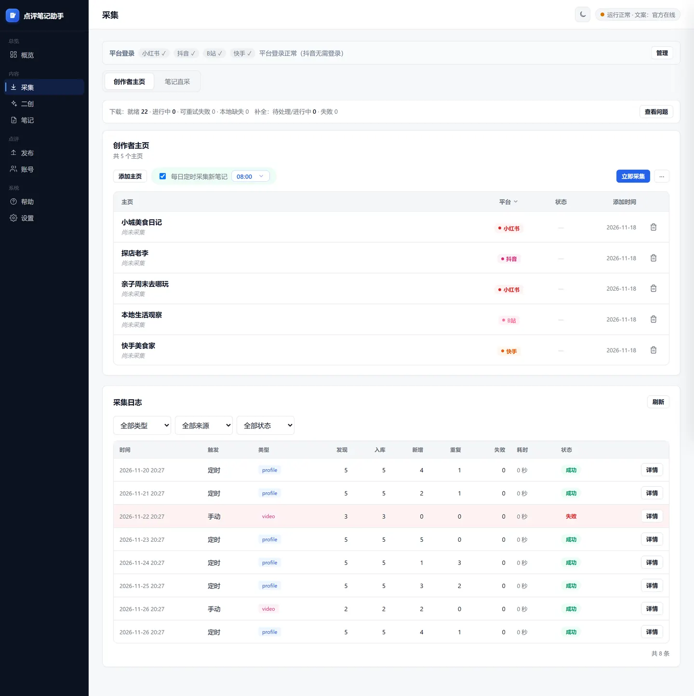
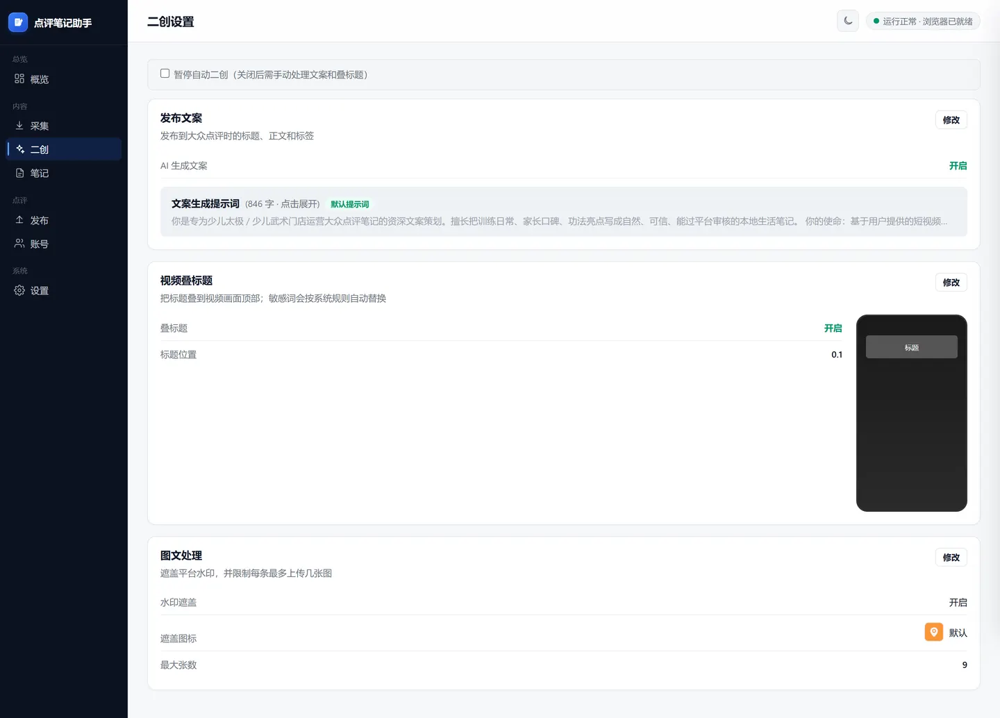
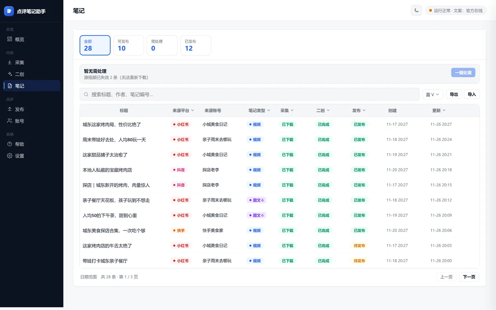
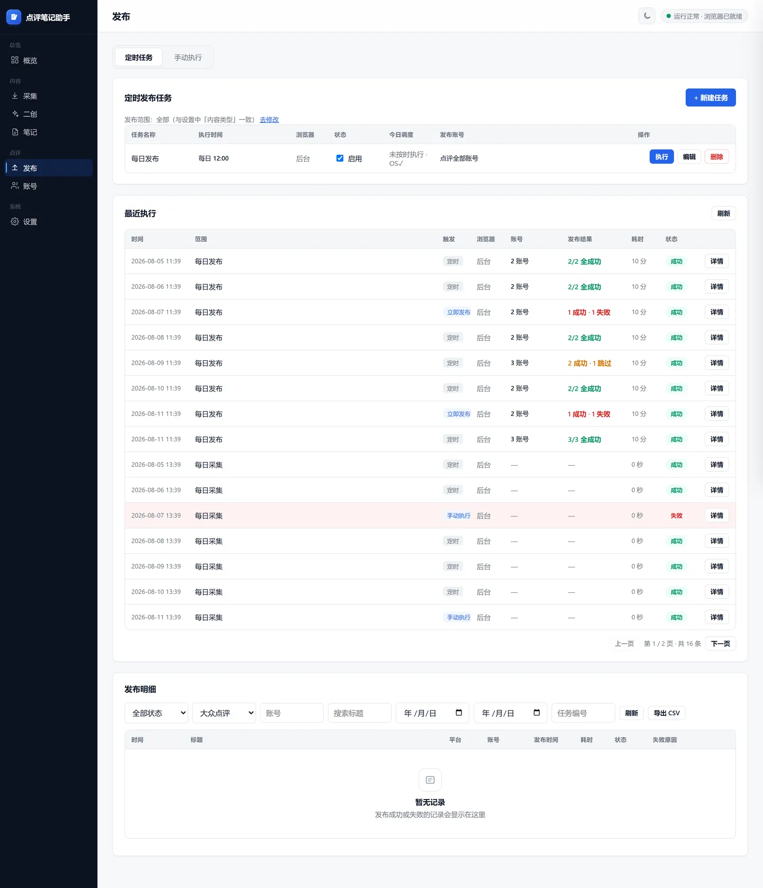
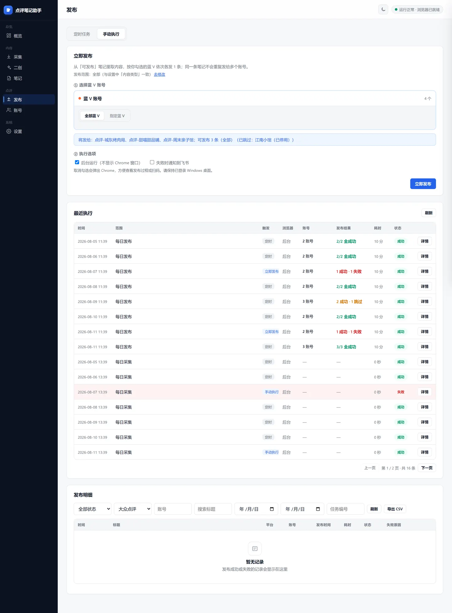
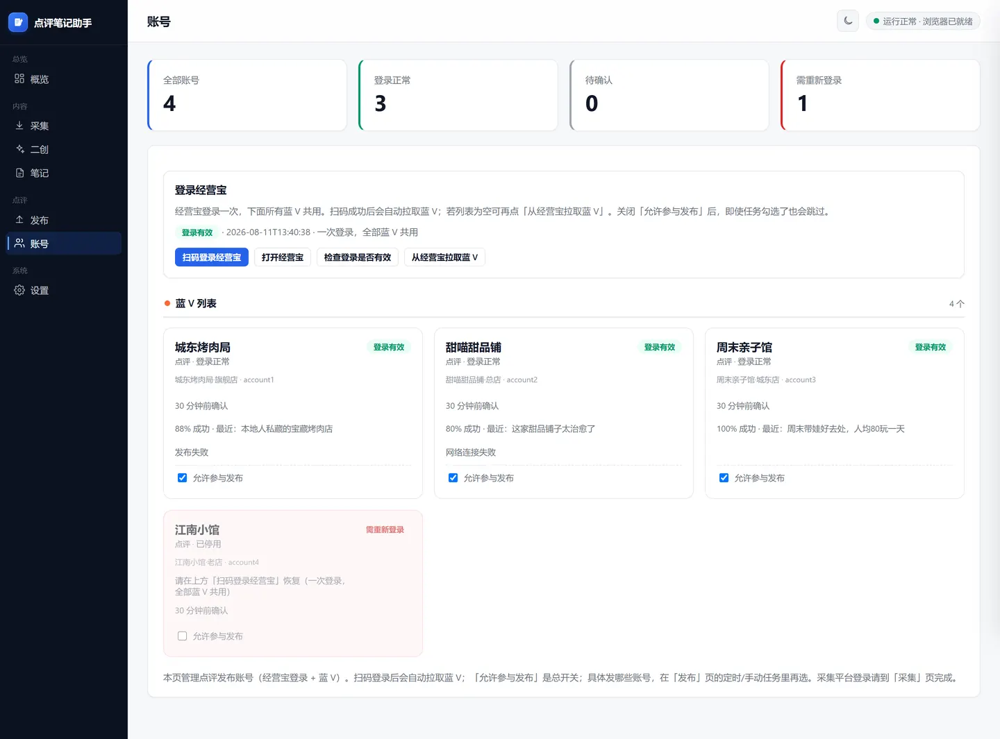
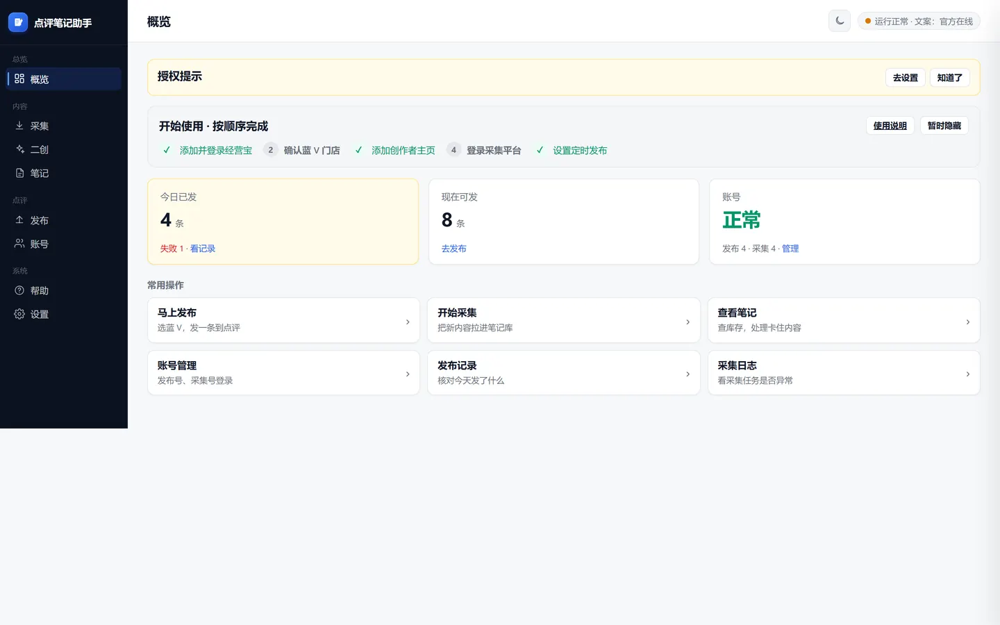
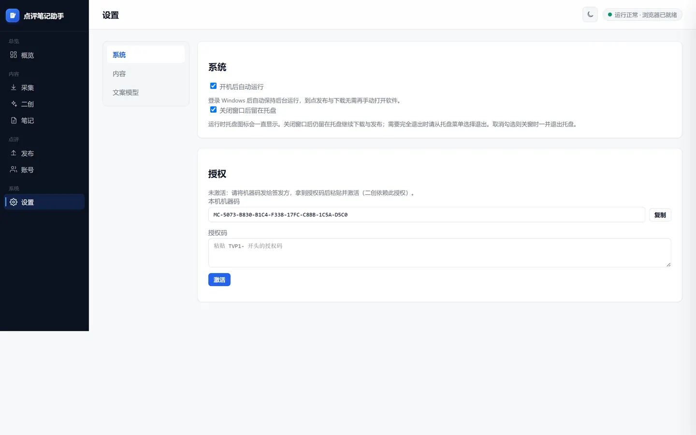

<div align="center">

# 点评笔记助手 · DianPingNote

**把「找素材 → 改内容 → 多号发布」做成一条本机流水线**

[官网](https://dianping-note.aiautotools.com) ·
[界面演示](https://dianping-note.aiautotools.com/screenshots) ·
[在线演示](https://dianping-note.aiautotools.com/demo/) ·
[定价](https://dianping-note.aiautotools.com/pricing) ·
[帮助中心](https://dianping-note.aiautotools.com/guides/getting-started)

[](https://dianping-note.aiautotools.com)
[](https://dianping-note.aiautotools.com)
[](LICENSE)
[](https://dianping-note.aiautotools.com/guides/install)
[](https://dianping-note.aiautotools.com/guides/data-and-privacy)

</div>

---

## 这是什么

点评笔记助手（DianPingNote）是一款给**点评门店运营**用的 Windows 桌面软件。

把同行的小红书 / 抖音 / 快手 / B 站主页加进来，软件每天到点自动采集笔记，在本机改写文案、把标题叠到视频顶部或遮盖图文水印，再按你设定的时间发布到大众点评经营宝下的多个蓝 V 门店账号。

**你只需要定三件事：采谁的主页、每天几点发、发给哪几个号。** 剩下的下载、改写、排队、上传，电脑按顺序跑完。

| | |
|---|---|
| 采集 | 小红书、抖音、快手、B 站：创作者主页定时采集 + 笔记直采（粘链接补一条） |
| 二创 | 本机改写标题与正文；视频标题烧到画面顶部；图文底部水印遮盖 |
| 发布 | 仅大众点评经营宝：一条笔记只由一个蓝 V 发；到点没跑会补发 |
| 状态 | 每条笔记在采集 / 二创 / 发布三段各有明确状态，失败告诉你卡在哪一步、什么原因 |
| 数据 | 笔记、素材、发布状态全部存在本机 SQLite，软件不上传笔记内容 |

## 界面一览

以下都是软件里的**真实界面截图**，不是示意图。

| 采集 | 二创 | 笔记 |
|---|---|---|
|  |  |  |
| 创作者主页定时采集与笔记直采 | 文案生成、叠标题与图文水印设置 | 三轴状态看全部笔记走向 |

| 定时发布 | 手动发布 | 账号 |
|---|---|---|
|  |  |  |
| 勾选蓝 V、设定每天执行时刻 | 随时手动跑一轮，用于补发 | 经营宝主体与蓝 V 门店分组管理 |

| 总览 | 设置 |
|---|---|
|  |  |
| 今日采集、二创、发布进度与待处理事项 | 开机启动、托盘驻留与软件授权 |

> 完整逐页说明见官网 [界面演示](https://dianping-note.aiautotools.com/screenshots)。

## 工作原理

软件在你自己的电脑上跑一条固定的流水线，每一步都有明确状态：

```
        ┌──────────────┐
        │  定时计划任务  │  ← Windows 计划任务，到点唤醒本机服务
        └──────┬───────┘
               ▼
   ┌───────────────────────┐
   │ ① 采集                │  创作者主页扫描 / 单条链接直采
   │   小红书·抖音·快手·B站 │  → 笔记入库（去重）
   └──────────┬────────────┘
              ▼
   ┌───────────────────────┐
   │ ② 下载素材            │  视频 / 图文落到本机 notes/ 目录
   └──────────┬────────────┘
              ▼
   ┌───────────────────────┐
   │ ③ 二创                │  改写标题与正文（授权在线文案）
   │   视频叠标题·图文遮水印│  → 产出可发布的成片
   └──────────┬────────────┘
              ▼
   ┌───────────────────────┐
   │ ④ 认领待发池          │  一条笔记只被一个蓝 V 账号认领
   └──────────┬────────────┘
              ▼
   ┌───────────────────────┐
   │ ⑤ 上传点评            │  经营宝登录态 → 蓝 V 门店 → 发布
   └──────────┬────────────┘
              ▼
   ┌───────────────────────┐
   │ ⑥ 回写状态 + 通知      │  本地 SQLite；可推飞书群机器人
   └───────────────────────┘
```

关键设计：

- **不黑箱。** 每条笔记在采集、二创、发布三段各有一个状态，失败时明确告诉你是哪一步、什么原因。
- **不重复发布。** 一条笔记只由一个蓝 V 账号认领发布；到点没跑会补发，不会重复发。
- **失败可回溯。** 发布明细保留时间、标题、平台、账号、耗时、失败原因，可导出 CSV。

## 快速上手（产品）

产品是 Windows 桌面软件，不在本仓库里。安装与使用见官网：

| 步骤 | 文档 |
|---|---|
| 装好软件 | [安装与运行要求](https://dianping-note.aiautotools.com/guides/install) |
| 采集平台登录 | [采集与登录](https://dianping-note.aiautotools.com/guides/collect) |
| 配置二创 | [二创设置](https://dianping-note.aiautotools.com/guides/erchuang) |
| 经营宝登录与蓝 V | [发布与定时](https://dianping-note.aiautotools.com/guides/publish) |
| 状态词典 | [状态与术语](https://dianping-note.aiautotools.com/guides/status-glossary) |
| 常见问题 | [故障排查](https://dianping-note.aiautotools.com/guides/troubleshooting) |

想先看效果：官网 [在线演示](https://dianping-note.aiautotools.com/demo/) 提供假数据演示，界面与产品一致。

## 本地开发（官网）

```bash
npm install
npm run dev      # http://127.0.0.1:5175
```

`npm run dev` 与 `npm run build` 都会先跑 `scripts/build_demo.mjs`。在没有产品源码的环境里它会跳过演示站，不报错。

### 构建

```bash
npm run build
```

构建链做三件事：

1. `build_seo.mjs --stage src` — 从 `data/faq.json` 生成 `faq.md`，校验每页 frontmatter 的 title/description
2. `vitepress build` — 出静态站
3. `build_seo.mjs --stage dist` — 生成 `sitemap.xml` / `robots.txt` / `llms.txt` / `llms-full.txt`，并交叉审计 sitemap 与 llms.txt 是否收录了未构建的页面

### 质量门禁

```bash
npm run verify     # GEO 写法 / 死链 / llms.txt 格式 / GEO 审计
```

### 部署

站点部署在 Cloudflare Pages（项目 `dianpingnote`，分支 `master`）。

```bash
npm run build
npx --yes wrangler@4 pages deploy .vitepress/dist --project-name=dianpingnote --branch=master
```

发版后由脚本向 IndexNow、Bing、百度与 Google Search Console 推送新 URL 与 sitemap。

## 仓库结构

| 目录 | 内容 |
|---|---|
| `index.md` 等页面 | 官网全部页面（首页、采集、二创、发布、价格、FAQ、指南、联系） |
| `guides/` | 帮助中心：首次上手、采集与登录、二创设置、发布与定时、状态词典、故障排查、数据与隐私 |
| `knowledge/` | 知识库：蓝 V 是什么、笔记限流、折叠隐藏、跨平台搬运、发布时段、多号排期 |
| `.vitepress/` | 站点配置与主题组件（DOM 结构、OG 图、JSON-LD、canonical） |
| `scripts/build_seo.mjs` | 构建后产出 `sitemap.xml`、`robots.txt`、`llms.txt`、`llms-full.txt`、每页 `.md` 镜像 |
| `scripts/seo_config.mjs` | 关键词、答案胶囊、事实要点、引用场景的**唯一维护点** |
| `scripts/build_demo.mjs` | 生成「在线体验」演示站 |
| `demo/` | 演示站的假数据层（72 个接口的 mock）与示例素材 |
| `data/faq.json` | FAQ 的唯一数据源，`faq.md` 由它生成 |
| `public/images/screenshots/` | 产品界面截图（WebP，由 `scripts/prepare_images.py` 从父仓 `docs/sales/screenshots/` 生成） |

## SEO / GEO

站点面向搜索引擎与生成式引擎做了结构化处理：

- 每页独立的 title / description / canonical / OG 标签
- `Organization` + `WebSite` + `SoftwareApplication` JSON-LD，FAQ 页追加 `FAQPage`
- `llms.txt` 与 `llms-full.txt`：给 AI 引擎的站点目录，含每页摘要、二级标题与事实速览
- `sitemap.xml` 带 `lastmod` / `changefreq` / `priority`
- 每页顶部有「一句话答案」胶囊，正文挂事实要点与站内引用链接

## 关于产品源码

**产品本身不开源。** 桌面端的采集、发布、授权等实现在另一个私有仓库里，本仓库不含任何产品代码。

「在线体验」演示站的界面用的是产品真实界面，但产品源码不在本仓库里，所以从 GitHub 克隆后构建出来的站点没有 `/demo/` 目录——那是预期行为。线上站点的 `/demo/` 由完整仓库在本机构建后部署，功能完整。

演示站里属于本仓库的部分是 `demo/src/`：**72 个接口的假数据层**，它演示的是「产品界面在没有后端时如何表现」，不涉及任何采集、发布、授权逻辑。

## 许可

本仓库的官网源码以 MIT 许可开放，见 [LICENSE](LICENSE)。

产品「点评笔记助手」为商业软件，源码不公开。商标与产品名称归各自所有者所有。

## 站点性质声明

点评笔记助手是独立运营的商业软件，与大众点评、美团及小红书等平台无隶属、授权或合作关系。采集与发布请自行遵守各平台的服务条款。
